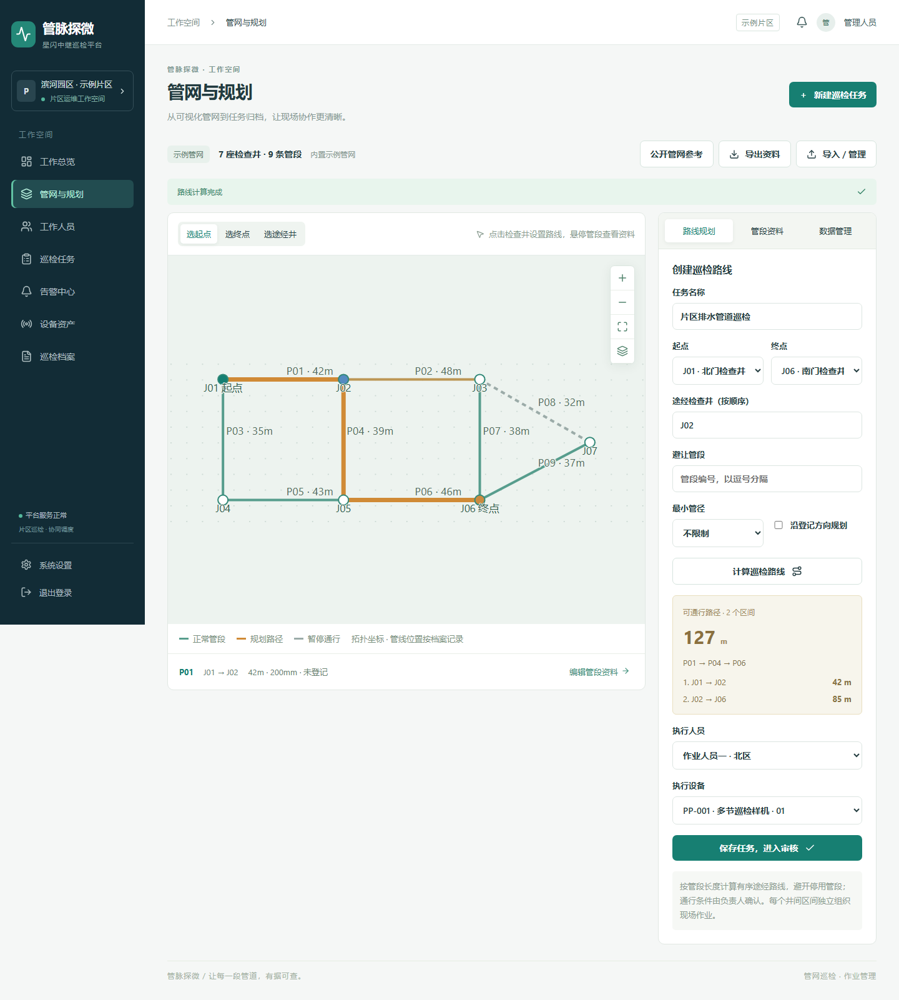
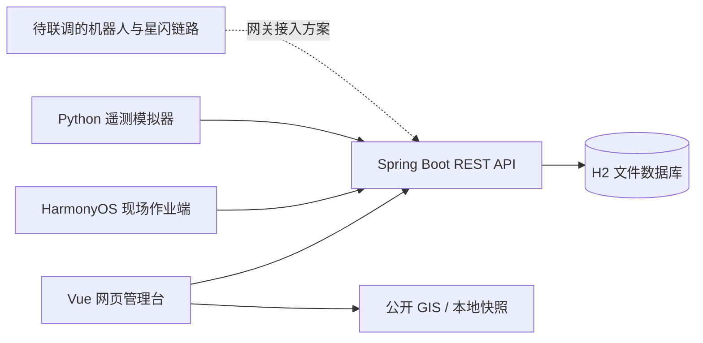

# PipePatrol · 管脉探微

**管脉探微——城市无压重力流排水管道低前置条件星闪中继巡检机器人**

管道巡检项目的软件原型，连接网页管理台、HarmonyOS 现场作业端和设备遥测接口，支持管网导入、约束路线规划、巡检任务流转、消息确认和异常告警。

[](LICENSE)



## 当前实现

| 模块 | 能力 |
| --- | --- |
| 网页管理台 | 工作总览、管网与路线规划、任务审核下发、人员管理、设备状态、告警确认、任务资料导出 |
| 路线规划 | Dijkstra 最短路径、有序途经井、管段避让、最小管径和方向约束，排除堵塞管段 |
| HarmonyOS 作业端 | 登录、本人任务、现场条件确认、开始/暂停/完成、现场反馈、消息与告警确认、视频 URL 接入 |
| 后端 | REST API、管理员/工作人员权限隔离、H2 持久化、密码摘要、遥测历史和任务事件记录 |
| 遥测模拟器 | 通过 Python 标准库发送电量、距离、温度与模拟告警，验证设备接入流程 |
| 公开管网参考 | 展示 City of Gold Coast 局部真实无压污水管网，支持 200—300 mm 筛选、属性查看和 GeoJSON 导出 |


## 组成与流程



任务主流程：`草稿 → 审核通过 → 下发 → 现场开始 → 完成 → 管理员复核`。运行中可暂停并恢复；设备上报告警时，系统产生告警并暂停任务。工作人员只能访问已下发给本人的任务及关联消息、告警和遥测。

## 目录

```text
backend/       Java 17 / Spring Boot 3.3.5 / H2 后端及集成测试
web/           Vue 3 / TypeScript / Vite 管理台及 Playwright 测试
harmony-app/   HarmonyOS 6.0.2 / API 22 / ArkTS 作业端
hardware/      遥测模拟器、选型与网关接入说明
shared/        遥测消息及管网导入示例
scripts/       启动、鸿蒙构建与接口联调脚本
docs/          接口文档、验证记录、数据来源和界面截图
```

## 快速运行

准备 JDK 17、Maven 3.8 或更新版本、Node.js 20.19 或更新版本。遥测模拟器和网页快捷启动脚本需要 Python 3。HarmonyOS 端单独使用 DevEco Studio 和 6.0.2 / API 22 SDK。

### 1. 获取代码

```shell
git clone https://github.com/Alt-2-cyber/PipePatrol.git
cd PipePatrol
```

### 2. 启动后端

```shell
cd backend
mvn package
java -jar target/pipepatrol-backend-0.1.0.jar
```

后端默认地址：`http://127.0.0.1:8080`；健康检查：`http://127.0.0.1:8080/api/health`。首次启动自动建立示例管网和账号。数据库写入 `backend/data/`，运行数据不纳入版本控制。

### 3. 在另一个终端启动网页

```shell
cd web
npm ci
npm run dev
```

访问 `http://127.0.0.1:5173`。Vite 将 `/api` 代理至本机 8080 端口。

| 本地演示角色 | 用户名 | 默认密码 |
| --- | --- | --- |
| 管理员 | `admin` | `PipeDemo2026!` |
| 工作人员 | `worker` | `WorkerDemo2026!` |

这些是公开的演示凭据。对外部署前，通过环境变量设置自己的初始化密码和设备密钥；已存在的账号不会因修改初始化变量而自动重置。

Windows 完成构建和依赖安装后，可使用 `scripts/start-backend.cmd`、`scripts/start-web.cmd` 或根目录的 `打开网页.cmd`。脚本使用 `JAVA_HOME` 和系统 `PATH`；指定 Python 可设置 `PIPE_PYTHON`。

## 配置

后端直接读取环境变量，不自动加载 `.env`。例如在 PowerShell 中，启动前执行 `$env:PIPE_PORT='8080'`。

| 环境变量 | 默认值 | 用途 |
| --- | --- | --- |
| `PIPE_BIND` | `127.0.0.1` | 服务监听地址；局域网联调可设置 `0.0.0.0` |
| `PIPE_PORT` | `8080` | 后端端口 |
| `PIPE_DATA` | `data/state.json` | 旧 JSON 导入路径及 H2 数据库路径基名 |
| `PIPE_ADMIN_PASSWORD` | 见演示账号表 | 首次建库的管理员密码 |
| `PIPE_WORKER_PASSWORD` | 见演示账号表 | 首次建库的工作人员密码 |
| `PIPE_DEVICE_KEY` | `pipepatrol-local-device` | 设备遥测 `X-Device-Key` 请求头 |

会话保存在内存中，服务重启后需重新登录。密码、设备密钥、数据库及现场资料应留在各自部署环境中。

## HarmonyOS 作业端

1. 用 DevEco Studio 打开 `harmony-app/`，同步项目并安装 HarmonyOS 6.0.2 / API 22 SDK。
2. 本机用 `scripts/start-backend-lan.cmd` 启动后端。手机与电脑接入同一局域网，并允许测试设备访问 8080 端口。
3. 在应用连接设置中填写电脑局域网地址，例如 `http://192.168.1.100:8080`。代码中的 `10.0.2.2` 默认地址用于模拟器场景，真机应改为实际地址。
4. 使用工作人员账号登录，执行已下发给本人的任务。

Windows 命令行构建可设置 `DEVECO_HOME` 为 DevEco Studio 安装目录，执行 `scripts/build-harmony.cmd`。若本机 `local.properties` 已有 `sdk.dir`，脚本也可据此定位工具。签名和 SDK 本地路径由开发者自行配置，不上传到仓库。

已有记录显示应用曾完成 unsigned HAP 编译；这不代表已完成真机、摄像头或机器人链路验证。历史证据见 [验证记录](docs/验证记录.txt)。


## 验证

```shell
# 后端集成测试
cd backend
mvn test

# 网页类型检查与生产构建
cd ../web
npm ci
npm run build

# 网页端到端测试：先启动独立的测试后端和网页服务
npx playwright install chromium
npx playwright test
```

Playwright 测试会创建人员与任务并修改示例管网，请使用单独的 `PIPE_DATA` 测试路径。CI 运行后端测试和网页构建，未包含鸿蒙 SDK、真实硬件或现场作业测试。


## 参与贡献与许可

欢迎通过 Issue 提交可复现问题，或通过 Pull Request 提交改进。提交前运行对应模块的验证，并保持演示数据、真实现场资料与硬件能力边界清晰。详见 [贡献说明](CONTRIBUTING.md)。

原创软件采用 [MIT License](LICENSE)。第三方数据、软件依赖和 SDK 继续遵循各自许可。
